# Executive summary

The service classifies English text as POSITIVE or NEGATIVE with `distilbert-base-uncased-finetuned-sst-2-english` (revision `714eb0f`), served by FastAPI under Gunicorn with Uvicorn workers. All tests pinned the service to CPUs 0–7 and the Locust load generator to CPUs 8–9 of an AMD EPYC 9334.

- **Default configuration** (2 workers × 4 threads, FP32): peaks at **130.6 req/s at 8 users**, falls to ~117 req/s at higher concurrency, and is stable for 15 minutes with no failures.
- **Worker/thread layout alone** changes FP32 capacity by at most **+8%**: every busy FP32 core delivers about 18 req/s, so the limit is the cost of a prediction.
- **Number format is the biggest lever.** In the best layout (8 single-threaded workers, at most 2 predictions per worker), **int8 gives 3.5×** FP32 throughput for 1.15 accuracy points, **BF16 gives 2.0×** with no accuracy change, and **FP16 is 2.6× slower** because the CPU has no native FP16 arithmetic.
- **Recommended configuration** (`PROFILE=throughput`): int8, 8 workers × 1 thread, limit 2. Against a baseline run in the same sitting: **peak 129.6 → 491.6 req/s (3.8×)**, **p95 at 64 users 830 → 260 ms**, for 1.15 points of SST-2 accuracy and ~2.9 GB more RAM. `PROFILE=accuracy` (BF16) gives 2.2× with unchanged accuracy.
- **No request failed** in any of the 16 sessions (about 1.46 million requests).

## Measured impact of each change

| Change (one at a time unless noted) | Measured effect | Decision |
|---|---|---|
| 8 workers × 1 thread instead of 2 × 4 | +7% peak, +17% at 64 users; single request 2.4× slower (p50 43 vs 18 ms) | kept, with a limit |
| Concurrency limit 2 per worker (8 × 1) | throughput unchanged at 16+ users; +62% over limit 1 at 8 users (128.4 vs 79.1 req/s); GIL waiting 61.6% → 8.7% with limit 1 | kept |
| Concurrency limit 1 per worker (8 × 1) | −43% at 8 users (idle cores), same at 16+ users | rejected |
| Concurrency limit 1 with 2 workers | −26% peak, CPU stuck at 64% | rejected |
| 8 threads per worker (2 × 8) | −20% peak; single request faster | rejected |
| 1 worker × 8 threads | −30% peak | rejected |
| 4 workers × 2 threads | −71% at 16 users | rejected |
| Per-request logging off | +1% (within run-to-run variation) | not needed |
| int8 dynamic quantization (in 8 × 1, limit 2) | 3.5× peak; accuracy −1.15 points | **kept** (throughput profile) |
| BF16 weights (in 8 × 1, limit 2) | 2.0× peak; accuracy unchanged | **kept** (accuracy profile) |
| FP16 weights (in 8 × 1, limit 2) | 2.6× slower | rejected |
| Combined: int8, 8 × 1, limit 2 vs default | 3.8× peak; p95 at 64 users −69% | **recommended** |

## Failures

Zero failed requests in every run. A failure was any non-200 response, an invalid JSON body, a label other than POSITIVE/NEGATIVE, or no response within 30 seconds. The highest p99 in any recommended or baseline run was 1.1 s, far below the 30 s timeout; FP16, the slowest configuration, reached a p99 of 3.5 s at 64 users and still did not fail.

# How the work was organised

The tests ran in stages, and each stage's conclusions decided what the next one tested. Every stage below states its question, why it was asked, what was run, the results, the conclusions with the reason for each, and why the next stage was designed the way it was.

| Stage | Question | Answer |
|---|---|---|
| 0. Preparation | Is the test environment controlled? | Yes: pinned cores, 0 failures, 0% steal, identical software in all sessions |
| 1. Baseline | How does the default service behave? | Peaks at ~130 req/s at 8 users, then falls while the CPU stays busy; stable for 15 minutes |
| 2. Workers and threads | Can a better layout raise capacity? | At most +8%; each FP32 core delivers ~18 req/s |
| 3. Number formats | Can cheaper arithmetic raise capacity? | int8 3.5×, BF16 2.0×, FP16 2.6× slower |
| 4. Profiling | Why did Stages 1–3 behave as they did? | The model is ~99% of the work; oversubscription explains falling throughput; CPU instructions explain the formats |
| 5. Final configuration | How does the chosen configuration compare with the default? | 3.8× peak throughput, p95 −69% at 64 users |

# Stage 0. Test environment and method

**Question.** Is the test environment controlled, and can its measurements be trusted?

**Why.** Every comparison assumes the machine, software and load generator stay the same between sessions, and that Locust is never the bottleneck.

**Setup.**

| Item | Setting |
|---|---|
| Hardware | AMD EPYC 9334 (Zen 4), 32 cores / 64 threads, 128 MiB L3, 502 GiB RAM. CPU flags: avx512f, avx512_vnni, avx512_bf16; no avx512_fp16 |
| CPU pinning | Service on CPUs 0–7 (`taskset`); Locust and the resource monitor on CPUs 8–9 |
| Software | Ubuntu 20.04.6, Python 3.11.17, torch 2.14.1+cpu, transformers 5.20.2, FastAPI 0.162.0, Gunicorn 26.2.0, Uvicorn 0.54.0 + uvicorn-worker 0.4.0, Locust 2.47.0, py-spy 0.4.2 |
| Model | revision `714eb0fa…`, loaded offline; inputs truncated at 128 tokens |
| Default service | 2 Gunicorn workers × 4 torch threads (threads = cores ÷ workers), FP32, no concurrency limit, INFO logging |
| Load | each Locust user sends requests back to back, so users = requests in flight; seeded 5:3:2 mix of short (~10 tokens), medium (~38) and long (~116) reviews |

| Scenario | Definition |
|---|---|
| Step | 1, 2, 4, 8, 16, 32, 64 users; 1 minute each |
| Length | 8 users; short texts only, then long texts only; 1 minute each |
| Spike | 4 users, then 64, then 4; 60 s each |
| Soak | 8 users for 15 minutes |

Every session starts a fresh server, waits for all workers, runs a 20 s unrecorded warm-up, discards the first second of each run, pauses 10 s between runs, and samples CPU and memory of every process once a second.

**Results.** 0 failures in ~1.46 million requests; the same pinning, run lengths and user levels in every session (`environment/settings.txt`); identical packages (`pip-freeze.txt`); steal time 0.0%; Locust at most 17% of one core. All sessions ran on commit `089c709` plus the same uncommitted changes.

**Conclusions.**

- **0.1 The environment was identical for every session.** *Reason:* settings, packages and CPU details match across all sessions, and every server log reports the intended configuration.
- **0.2 Neither Locust nor the host limited any result.** *Reason:* Locust never exceeded 17% of one of its two cores, and steal time was 0%.

**Why Stage 1 was designed this way.** With a trustworthy environment, the next step was a reference measurement of the default configuration in every scenario, including the soak, plus an identical repeat to measure how much results vary between identical runs.

# Stage 1. Baseline

**Question.** How does the default service behave under load, where does it saturate, is it stable, and how noisy are the measurements?

**What was run.**

```
LABEL=baseline bash loadtests/run_load_tests.sh step length spike soak
LABEL=baseline-repeat bash loadtests/run_load_tests.sh step
python profiling/compare_sessions.py loadtests/results/*_baseline \
    loadtests/results/*_baseline-repeat --output profiling/results/noise_level.md
```

**Results** (`loadtests/results/20261025-104847_baseline`):

| Run | Req/s | p50 | p95 | p99 | Server CPU | Server RSS |
|---|---|---|---|---|---|---|
| 1 user | 51.0 | 18 ms | 42 ms | 42 ms | 49% | 1,228 MB |
| 2 users | 93.3 | 19 ms | 45 ms | 48 ms | 98% | 1,225 MB |
| 4 users | 119.8 | 28 ms | 64 ms | 69 ms | 82% | 1,258 MB |
| **8 users** | **130.6** | 50 ms | 130 ms | 130 ms | 92% | 1,324 MB |
| 16 users | 127.0 | 110 ms | 270 ms | 310 ms | 92% | 1,440 MB |
| 32 users | 116.3 | 260 ms | 430 ms | 490 ms | 88% | 1,715 MB |
| 64 users | 117.6 | 540 ms | 950 ms | 1,100 ms | 91% | 2,196 MB |
| Short texts, 8 users | 209.2 | 37 ms | 45 ms | 50 ms | 85% | 1,566 MB |
| Long texts, 8 users | 62.3 | 130 ms | 140 ms | 150 ms | 96% | 1,592 MB |
| Spike 4 → 64 → 4 | 118.2 | 35 ms | 710 ms | 870 ms | 86% | 2,308 MB |
| Soak, 8 users, 15 min | 131.7 | 49 ms | 120 ms | 130 ms | 94% | 1,683 MB |

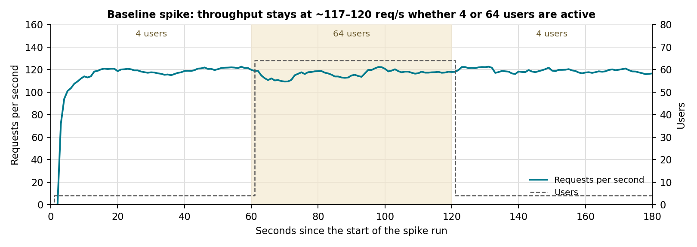

**How to read it.** The shaded band is the minute when users jumped from 4 to 64. If the service had spare capacity, the solid line would rise in that band. It doesn't: it stays at about 117–120 req/s before, during and after. With 4 users the service is already almost saturated, so 16 times the users only lengthens the queue, which is what the response-time chart below shows.

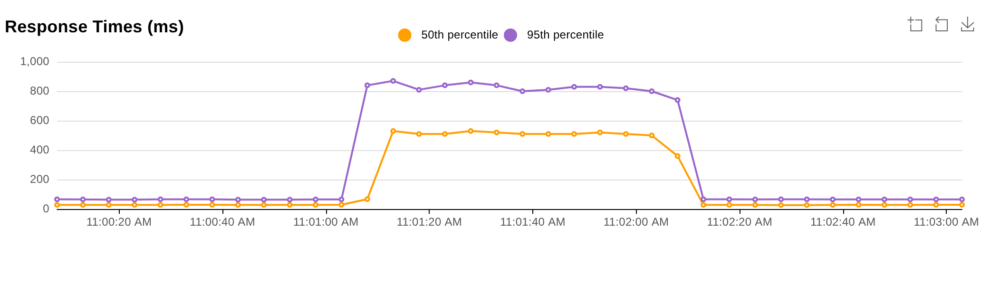

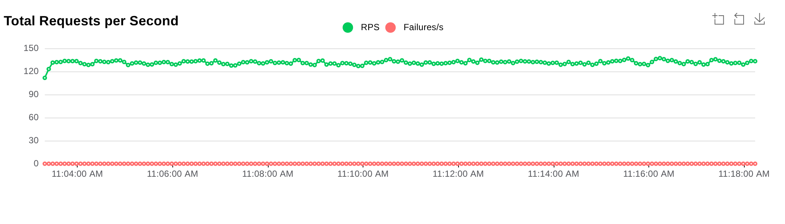

**How to read it.** Users are constant here, so the line should be flat if the service is stable. It is: 130–133 req/s every minute after the first, with no downward drift. A memory leak or resource exhaustion would show as the line slowly falling, or as red failures, which stay at zero.

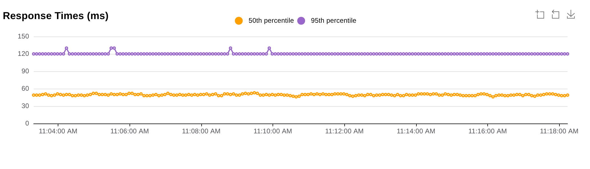

| Noise check | Result |
|---|---|
| Baseline against an identical repeat | throughput within 1% at 6 of 7 levels (−10% at 4 users); p50 within 6%; p95/p99 up to 19% apart (52% at 4 users) |
| Three baselines run hours apart | peak 130.6, 130.4 and 129.6 req/s |

Throughput is therefore reliable to within a few percent, while tail latencies (p95/p99) can move by up to about 20% between identical runs; small tail-latency differences in later stages are treated with that in mind.

**Conclusions.**

- **1.1 The service saturates at 8 users, at ~130 req/s.** *Reason:* throughput roughly doubles from 1 to 2 users, still rises to 4, and peaks at 8 users with the CPU 92% busy; more users add no throughput.
- **1.2 Beyond saturation, throughput falls while the CPU stays busy.** *Reason:* 130.6 → 116.3 req/s from 8 to 32 users (−11%, far more than the ~1% two identical runs differ by) at 88–92% CPU. Full cores would hold throughput flat; a fall means part of the cores' time goes to something other than predictions. The only thing that changes with more users is more requests running at once inside each worker.
- **1.3 Latency beyond saturation is queueing.** *Reason:* Little's Law at 64 users: 64 ÷ 117.6 req/s ≈ 544 ms against a measured p50 of 540 ms; p50 roughly doubles with each doubling of users above 8.
- **1.4 Long texts cost ~3.4× short ones.** *Reason:* 62 vs 209 req/s at the same 8 users; only input length differs.
- **1.5 The service is stable.** *Reason:* no failures; p95 back to ~65 ms immediately after the spike; flat throughput, latency and memory over the 15-minute soak.

**Why Stage 2 was designed this way.** Conclusion 1.2 raised two questions: is the fall caused by how requests share workers and threads, and could another layout of the same 8 cores do more? Both concern three settings: worker processes, torch threads per worker, and predictions allowed per worker. Stage 2 tested eight layouts across that range, each differing from the baseline in one idea: **2×8** (ignoring the thread-splitting rule), **1×8** and **4×2** (fewer vs more workers), **8×1** (one single-threaded worker per core), **2×4 limit 1** (one prediction per worker), **8×1 limit 1** and **limit 2**, and **quiet logs**. A fresh baseline ran in the same sitting. The soak was dropped (1.5); step, length and spike at all seven levels were kept, since 1.2 appears above 8 users and single-request latency at 1 user.

# Stage 2. Workers, threads and concurrency (FP32)

**Question.** Can a different arrangement of worker processes, threads per worker and predictions allowed per worker make better use of the same 8 cores?

**What was run.**

```
SCENARIOS="step length spike" bash profiling/run_experiments.sh \
  "oversubscribed-2x8|GUNICORN_WORKERS=2 APP_TORCH_NUM_THREADS=8" \
  "workers-1x8|GUNICORN_WORKERS=1 APP_TORCH_NUM_THREADS=8" \
  "workers-4x2|GUNICORN_WORKERS=4 APP_TORCH_NUM_THREADS=2" \
  "workers-8x1|GUNICORN_WORKERS=8 APP_TORCH_NUM_THREADS=1" \
  "workers-2x4-limit1|APP_MAX_CONCURRENT_PREDICTIONS=1" \
  "workers-8x1-limit1|GUNICORN_WORKERS=8 APP_TORCH_NUM_THREADS=1 APP_MAX_CONCURRENT_PREDICTIONS=1" \
  "workers-8x1-limit2|GUNICORN_WORKERS=8 APP_TORCH_NUM_THREADS=1 APP_MAX_CONCURRENT_PREDICTIONS=2" \
  "quiet-logs|APP_LOG_LEVEL=WARNING"
```

**Results** (`profiling/results/experiments_20261025-123021/`, requests per second):

| Layout | Limit | 1 user | 8 users | 16 users | 64 users | Peak | p95 at 64 | vs baseline |
|---|---|---|---|---|---|---|---|---|
| 2×4 (baseline) | – | 50.8 | 130.4 | 126.0 | 116.7 | 130.4 | 830 ms | – |
| 2×8 | – | 75.3 | 104.8 | 102.8 | 98.8 | 104.8 | 960 ms | −20% |
| 1×8 | – | 75.2 | 86.2 | 83.1 | 85.6 | 91.6 | 920 ms | −30% |
| 4×2 | – | 30.7 | 65.4 | 36.5 | 99.1 | 104.1 | 1,200 ms | −20% |
| 8×1 | – | 20.5 | 139.7 | 139.7 | 136.8 | 139.7 | 1,100 ms | +7% |
| 2×4 | 1 | 50.8 | 95.6 | 96.1 | 94.8 | 96.1 | 870 ms | −26% |
| 8×1 | 1 | 20.5 | 79.1 | 140.1 | 129.7 | 140.1 | 870 ms | +7% |
| **8×1** | **2** | 20.5 | 128.4 | 140.3 | 138.9 | **140.3** | 1,000 ms | **+8%** |
| 2×4, WARNING logs | – | 51.1 | 131.1 | 127.7 | 117.8 | 131.1 | 930 ms | +1% |

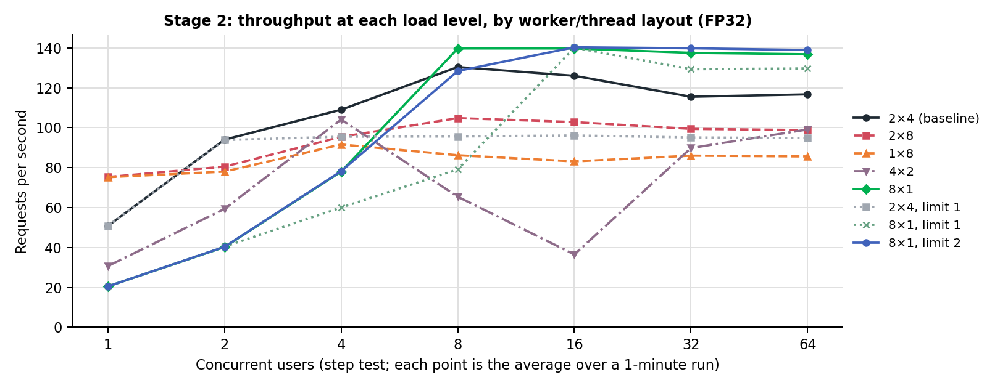

**How to read it.** Each line is one layout; moving right means more simultaneous users. A line that keeps rising has spare capacity; where it flattens, the service is saturated; a line that falls after its peak is losing capacity under contention. Three things stand out: no line goes much above 140 req/s (conclusion 2.1); the multi-threaded layouts (black, red, orange) start higher at 1–2 users but end lower; and 4×2 (purple dash-dot) drops sharply in the middle.

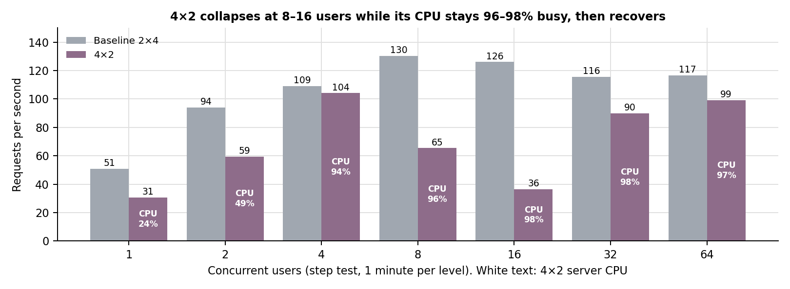

**How to read it.** At 4 users the two layouts are almost equal (104 against 109 req/s). At 8 and 16 users, 4×2 falls to 65 and 36 req/s while its CPU stays at 96–98%: the cores are busy, but producing far fewer results. At 32 and 64 users it recovers to 90–99 req/s. Section 4.5 explains why.

| 8 users | CPU of each worker (% of one core) | Busy cores | Req/s |
|---|---|---|---|
| 8×1, no limit | 284, 284, 98, 98, 0, 0, 0, 0 | 7.6 | 139.7 |
| 8×1, limit 1 | 100, 100, 98, 98, 0, 0, 0, 0 | 4.0 | 79.1 |
| 8×1, limit 2 | 197, 195, 98, 98, 98, 0, 0, 0 | 6.9 | 128.4 |

**Conclusions.**

- **2.1 No layout raised FP32 capacity by more than 8%.** *Reason:* the best, 8×1 limit 2, peaked at 140.3 req/s and held +19% at 64 users; nothing exceeded ~140 req/s.
- **2.2 Every busy FP32 core delivers ~18 req/s, whatever the layout: the ceiling is the cost of a prediction.** *Reason:* baseline 130.6 req/s on 7.4 busy cores; 8×1 139.7 on 7.7; 8×1 limit 2 140.3 on 7.8.
- **2.3 More threads per request give faster single requests but less capacity.** *Reason:* 1×8 and 2×8 served one user fastest (p50 12 ms) but lost 30% and 20% of peak; 8×1 was slowest for one user (p50 43 ms) and highest from 16 users up.
- **2.4 Only layouts with several torch threads per worker lost throughput as users increased.** *Reason:* baseline, 2×8 and 4×2 fell; 8×1 stayed flat, and 2×4 limit 1 (one 4-thread prediction per worker) stayed at ~95 req/s.
- **2.5 The limit must suit the number of workers.** *Reason:* with 2 workers, limit 1 capped throughput at ~95 req/s with CPU at 64%; with 8 workers, limit 1 left cores idle at 8 users and limit 2 was best.
- **2.6 Connections land unevenly on workers at 4–16 users.** *Reason:* at 8 users only 4–5 of 8 workers had requests; without a limit a busy worker compensates on several cores (284%). Partly a test artefact: Locust keeps one connection per user.
- **2.7 4×2 collapsed at 8–16 users.** *Reason:* 104 → 65 → 36.5 req/s at 4, 8 and 16 users with CPU 96–98%, recovering at 32–64 users. The drop is far larger than the run-to-run variation measured in Stage 1 (−71% against about 1%).
- **2.8 Per-request logging has no measurable cost for FP32.** *Reason:* +1% peak, within the run-to-run variation.

**Why Stage 3 was designed this way.** By 2.2, only a cheaper prediction can add capacity. Stage 3 tested number formats, which change the cost of the arithmetic: **int8** (dynamic quantization of the Linear layers), **BF16** and **FP16**, plus FP32 as reference, all in the best layout (8×1, limit 2) so the format is the only difference. An **accuracy check** on the 872 SST-2 validation sentences ran alongside, because a format can change predictions. Conclusions 1.2, 2.3, 2.4 and 2.7 were left to Stage 4.

# Stage 3. Number formats

**Question.** Can cheaper arithmetic make each prediction cheaper, and so raise capacity, without losing accuracy?

**What was run.**

```
APP_TORCH_NUM_THREADS=1 taskset -c 0 python profiling/check_accuracy.py \
    --variants baseline quantized bf16 fp16
SCENARIOS="step length spike" bash profiling/run_experiments.sh \
  "fp32-8x1-limit2|GUNICORN_WORKERS=8 APP_TORCH_NUM_THREADS=1 APP_MAX_CONCURRENT_PREDICTIONS=2" \
  "int8-8x1-limit2|APP_QUANTIZE=true GUNICORN_WORKERS=8 APP_TORCH_NUM_THREADS=1 APP_MAX_CONCURRENT_PREDICTIONS=2" \
  "bf16-8x1-limit2|APP_PRECISION=bf16 GUNICORN_WORKERS=8 APP_TORCH_NUM_THREADS=1 APP_MAX_CONCURRENT_PREDICTIONS=2" \
  "fp16-8x1-limit2|APP_PRECISION=fp16 GUNICORN_WORKERS=8 APP_TORCH_NUM_THREADS=1 APP_MAX_CONCURRENT_PREDICTIONS=2"
```

**Results** (`profiling/results/accuracy_20261025-152236.md`, `profiling/results/experiments_20261025-152828/`):

| Format | SST-2 accuracy | Same label as FP32 | Time per sentence (1 thread) | Model size |
|---|---|---|---|---|
| FP32 | 91.06% | 100% | 35.8 ms | 255.5 MB |
| int8 | 89.91% | 95.87% | 8.6 ms (4.15× faster) | 132.3 MB |
| BF16 | 91.06% | 100% | 18.2 ms (1.96× faster) | 127.7 MB |
| FP16 | 91.06% | 100% | 94.9 ms (0.38×) | 127.7 MB |

| 8×1, limit 2 | 1 user (p50) | 8 users | Peak | 64 users (p95) | Long texts | Server RSS idle / peak |
|---|---|---|---|---|---|---|
| FP32 | 20.5 (43 ms) | 113.0 | 139.7 | 138.7 (1,000 ms) | 64.0 | 4.4 / 5.6 GB |
| int8 | 74.7 (8 ms) | 439.0 | 491.6 | 485.8 (260 ms) | 192.5 | 5.6 / 5.1 GB |
| BF16 | 39.1 (22 ms) | 256.3 | 282.9 | 280.4 (420 ms) | 101.3 | 4.1 / 4.7 GB |
| FP16 | 6.5 (130 ms) | 38.9 | 52.8 | 51.0 (2,800 ms) | 15.6 | 4.0 / 4.4 GB |

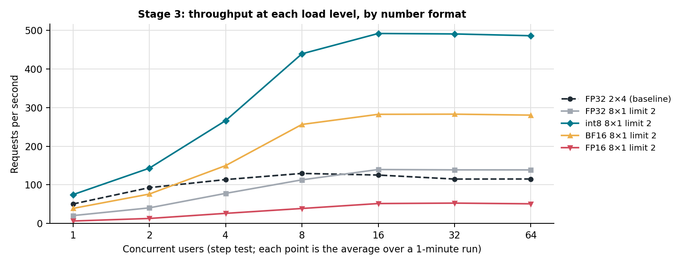

**How to read it.** The format changes the height at which each line flattens, which is its capacity: about 490 req/s for int8, 280 for BF16, 140 for FP32 and 53 for FP16. The FP32 8×1 line (grey) is the fair reference for the formats, because only the format differs from it.

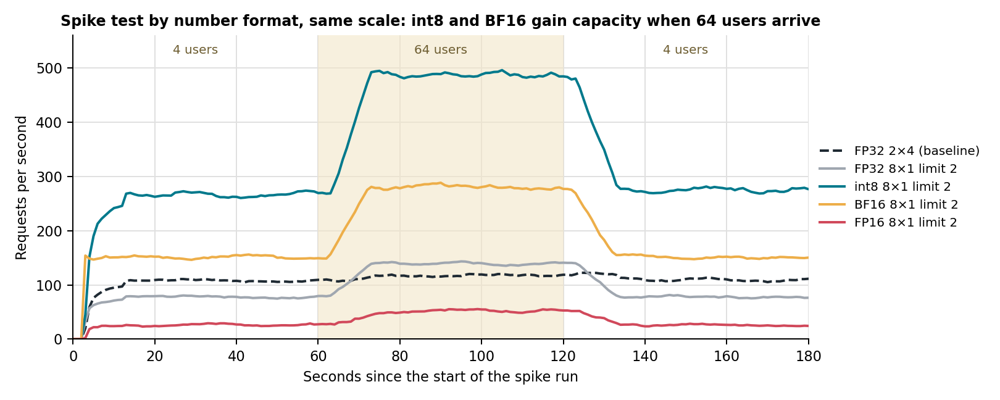

**How to read it.** Each line is one configuration's spike run; the shaded minute has 64 users, the rest 4. Average requests per second in each stage:

| Configuration | 4 users | 64 users | 4 users again |
|---|---|---|---|
| FP32 2×4 (baseline) | 107 | 117 | 110 |
| FP32 8×1 limit 2 | 77 | 138 | 79 |
| int8 8×1 limit 2 | 265 | 485 | 278 |
| BF16 8×1 limit 2 | 151 | 279 | 152 |
| FP16 8×1 limit 2 | 26 | 51 | 27 |

The baseline barely rises when 64 users arrive, because its 4-thread predictions already keep most cores busy with 4 users. The 8×1 configurations roughly double, because with 4 users only about 4 of their 8 single-threaded workers have work, and with 64 users all 8 do. All of them return to their 4-user level as soon as the spike ends, with no lasting slowdown.

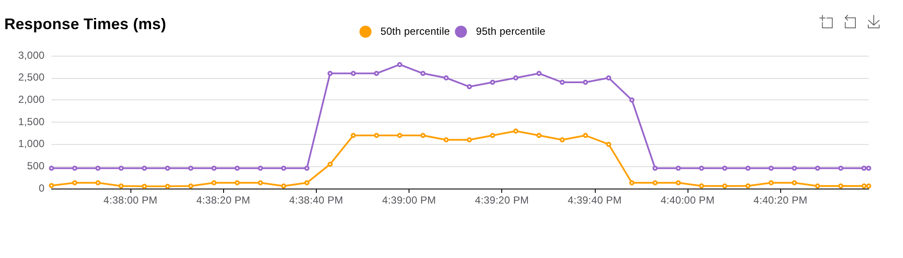

**Conclusions.**

- **3.1 int8 raised capacity 3.5× and gave the fastest single request, for 1.15 accuracy points.** *Reason:* 491.6 vs 139.7 req/s, p50 8 ms. The models disagreed on 36 of 872 sentences and int8 was right on 13; McNemar's test gives p ≈ 0.13, so the loss is probable but not certain.
- **3.2 BF16 doubled capacity with no accuracy change.** *Reason:* 282.9 req/s, 91.06% accuracy, 100% agreement.
- **3.3 FP16 was 2.6× slower than FP32.** *Reason:* 52.8 vs 139.7 req/s, p95 2.8 s at 64 users, despite the same memory saving as BF16.
- **3.4 Worker memory did not follow model size.** *Reason:* BF16/FP16 workers saved 34–43 MB each although weights are ~128 MB smaller; int8 workers started 157 MB higher than FP32 (705 vs 548 MB) yet ended lower at peak (5.1 vs 5.6 GB).

**Why Stage 4 was designed this way.** The reasons behind 3.1–3.4 and the open questions from Stages 1–2 needed explaining before choosing. Each question got the measurement that could answer it: **stage timings** (one prediction, no server) for where time goes and how threads and formats change it; **flame graphs at 32 users** for nine layouts and formats; the **CPU feature flags**; and, for the 4×2 collapse, **per-worker CPU** and a flame graph of **every worker** at 4 users (normal) and 16 users (worst).

# Stage 4. Profiling

**Question.** Why did Stages 1–3 behave as they did?

**What was run.**

```
grep -o -E 'avx512_bf16|avx512_fp16|avx512_vnni|avx512f' /proc/cpuinfo | sort -u
APP_TORCH_NUM_THREADS=4 taskset -c 0-3 python profiling/profile_stages.py --label fp32-4threads
APP_TORCH_NUM_THREADS=1 [APP_QUANTIZE=true | APP_PRECISION=bf16|fp16] taskset -c 0 \
    python profiling/profile_stages.py --label {fp32,int8,bf16,fp16}-1thread
USERS=32 RATE=20|25 [settings] bash profiling/profile_server.sh <label>-32u          # 9 graphs
TARGET=each RATE=25 USERS=4|16 GUNICORN_WORKERS=4 APP_TORCH_NUM_THREADS=2 \
    bash profiling/profile_server.sh workers-4x2-{4u,16u}                     # one per worker
python profiling/analyze_flamegraph.py <svg>;  python profiling/worker_balance.py <session>
```

## How to read the flame graphs in this section

A flame graph summarises thousands of snapshots. py-spy paused one worker 25 times a second for 60 seconds and recorded, for every active thread, its full chain of function calls. The graph merges those snapshots:

1. **Top to bottom is the call chain.** The root, `all`, is at the top. Each row below shows the functions called by the row above, so reading downwards answers "and what did that call?"
2. **Width is time.** A bar's width is the share of all snapshots in which that function was on the call chain. Left to right is alphabetical, not time, and colours carry no meaning.
3. **The bottom edge of a tower is where the time went.** The part of a bar with nothing underneath it is time spent in that function itself.
4. **Search totals a function that appears in many places.** Each figure below was made with the graph's own Search box (top right of the SVG): matching frames turn pink, and the graph reports the matched share, given in each caption. Opening the SVG and typing the same term reproduces it.
5. **Waiting is not CPU use.** py-spy records every thread, including threads that are asleep waiting for a lock. A share of samples is a share of *thread-time*: with one thread computing and three waiting, the graph shows 75% waiting while the core is fully busy. PyTorch's OpenMP helper threads are not Python threads and do not appear.

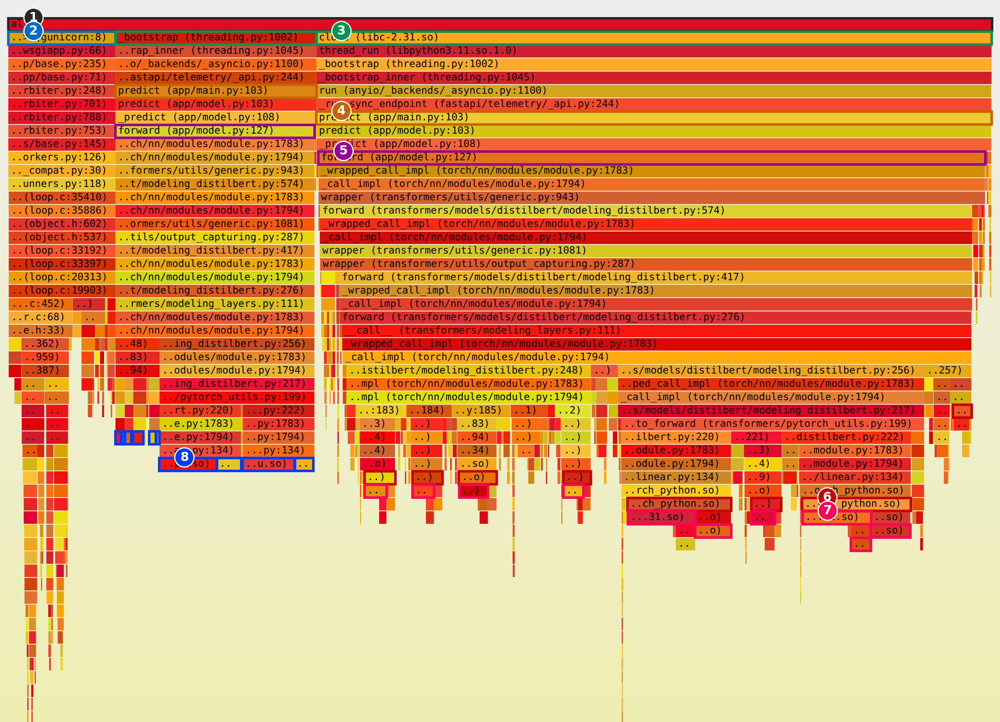

| Marker in the guide | Frame | What it is | Share |
|---|---|---|---|
| 1 | `all` | every sample | 100% |
| 2 | `<module> (gunicorn:8)` | the worker's event-loop thread: accepting, parsing, responding | 10.9% |
| 3 | `clone` and `_bootstrap` | the request threads of FastAPI's thread pool (the same threads, traced to different depths) | 68.7% + 20.4% |
| 4 | `predict (app/main.py)` | the `/predict` endpoint | 89% |
| 5 | `forward (app/model.py)` | the forward pass | 88% |
| 6 | `pybind11::gil_scoped_release` | PyTorch taking the GIL back after an operation | 44% |
| 7 | `pthread_cond_timedwait`, `__lll_lock_wait` | a thread asleep, waiting for the GIL | 61.6% (search) |
| 8 | `mkl_blas_def_sgemm_kernel_0_zen` | FP32 matrix multiplication: the useful work | ~20% |

## 4.1 What can be optimised? (1.4, 2.2)

| FP32, 4 threads, batch 1 | Tokenize | Forward pass | Post-process | Forward share | Web layer |
|---|---|---|---|---|---|
| Short (10 tokens) | 0.22 ms | 10.30 ms | 0.03 ms | 97.6% | +2.41 ms |
| Medium (38 tokens) | 0.32 ms | 18.22 ms | 0.03 ms | 98.1% | +2.55 ms |
| Long (116 tokens) | 0.53 ms | 39.71 ms | 0.03 ms | 98.6% | +2.57 ms |


**Reading the figure.** Follow the request column down from marker 4 (`predict`) to `_predict`. Its row splits into three children. Almost the whole width goes to `forward`; `tokenize` and `postprocess` are a few pixels wide and need the zoom panels to be seen. Search confirms it: `forward \(app/model` matches 88%, `tokenize \(app` 0.5%, `postprocess \(app` 0.3%.

- **4.1 The forward pass is 96.7–99.9% of every prediction.** *Reason:* all 45 stage-timing cases (5 variants × 3 lengths × 3 batch sizes), and the same split is visible under load in the figure. With 4 threads it costs ≈ 7.7 ms + 0.28 ms per token, explaining 1.4. Batching made short texts 2.3× cheaper per text but not long ones; the web layer adds 2–2.6 ms.

## 4.2 Why more threads per request give less capacity (2.3)

- **4.2 Splitting one small prediction across threads wastes part of every core.** *Reason:* 4 threads made a prediction only 2.1–2.7× faster than 1 thread (short 10.5 vs 22.6 ms, long 40.3 vs 107.4 ms): 53–67% parallel efficiency. Single-threaded workers get more total work from 8 cores; multi-threaded workers answer each request sooner.

## 4.3 Why throughput falls with more users (1.2, 2.4)


**What to look for.** `libgomp` is the OpenMP library PyTorch uses to split each operation across threads. When a request thread finishes its share of an operation, it waits inside libgomp until the helper threads finish theirs. Its frames have no readable names (they show as addresses such as `0x7f… (libgomp.so.1)`), which is why searching for the library name is the easiest way to find them. They sit at the bottom of the request towers, under PyTorch's parallel operations (C).

| Graph | Torch threads per worker | Search `libgomp` | Meaning |
|---|---|---|---|
| Baseline 2×4 | 4 | 4.0% | some time lost to threads waiting on each other |
| Oversubscribed 2×8 | 8 | 9.3% | more than twice as much: more threads competing for the same 8 cores |

- **4.3 Thread oversubscription makes busy cores less productive.** *Reason:* each request splits its maths over several OpenMP threads and each worker runs several requests at once, so there are far more maths threads than cores; the time request threads spend waiting in libgomp more than doubles when threads per worker double. With 2.4 (8×1 and 2×4 limit 1, which avoid this, do not lose throughput), this explains why throughput falls while the CPU stays busy.

## 4.4 What the concurrency limit changes (2.5), and why it did not add throughput


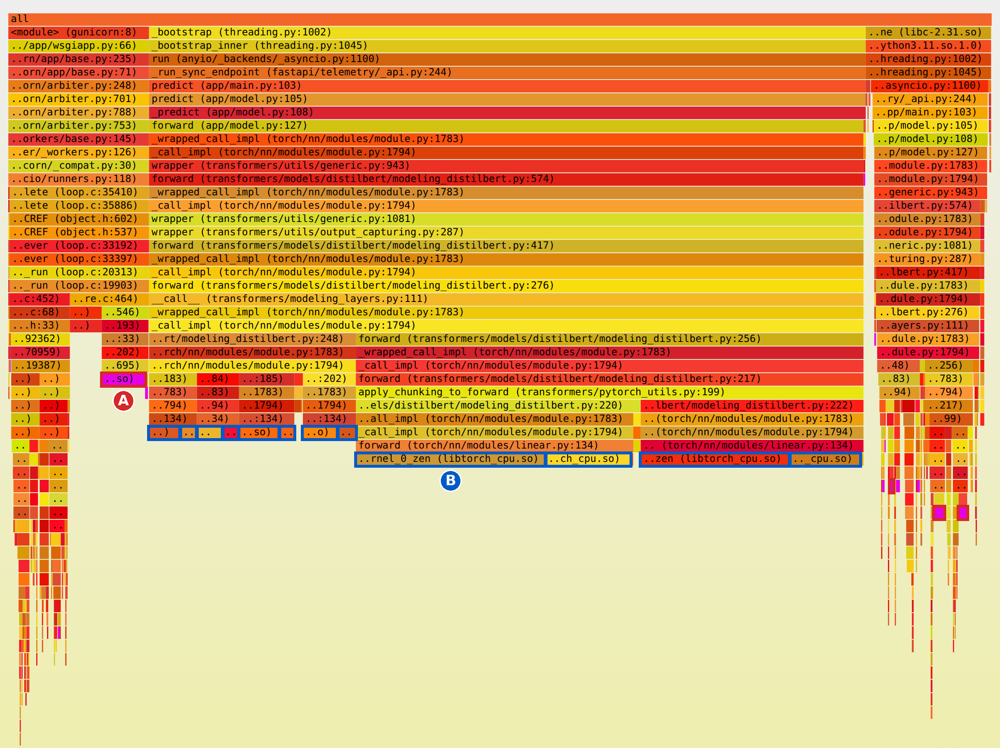

**How to read the two graphs.** Start at `forward` (marker 5 in the guide) and follow the widest tower down through the DistilBERT layers to `linear.py`, then into PyTorch's C++ code. Each tower ends in one of two ways:

- **A, waiting.** `THPVariable_linear` → `pybind11::gil_scoped_release` → `pthread_cond_timedwait` or `__lll_lock_wait`. The operation has finished and the thread is asleep, waiting for Python's Global Interpreter Lock so it can run the next line of Python.
- **B, working.** `mkl_blas_def_sgemm_kernel_0_zen`: the matrix multiplication itself.

| | A, waiting for the GIL (search) | B, matrix multiplication | Req/s at 16 users | Busy cores |
|---|---|---|---|---|
| 8×1, no limit | 61.6% | ~20% | 139.7 | 7.8 of 8 |
| 8×1, limit 1 | 8.7% | ~73% | 140.1 | 7.8 of 8 |

The search counts every wait in those two functions. `analyze_flamegraph.py` separates them by what is above them: with limit 1, 3.5% are GIL waits and 5.2% are other waits, mostly requests queued for their turn.

Without the limit, about 4 requests run at once in each worker; their operations can overlap because PyTorch releases the GIL during each one, but between operations all of them need the GIL back, so at most moments one thread computes and the rest wait. With limit 1, only one request runs the model per worker, so almost nothing waits for the GIL and B fills the graph.

- **4.4 The limit removes GIL contention but cannot raise throughput when the CPU is already saturated.** *Reason:* waiting fell from 61.6% to 8.7%, yet throughput stayed at ~140 req/s with 7.8 of 8 cores busy both times. A waiting thread is asleep and uses no CPU, so the 61.6% was thread-time, not lost CPU; the cores were already busy with useful work. With the limit, the extra requests still wait, in the semaphore queue instead of for the GIL; the gain is fairer waiting and a freer event loop (p95 at 64 users 1,100 → 870 ms, a change close to the ~20% tail-latency variation between identical runs), not capacity.

## 4.5 Why 4×2 collapses (2.7)

| 4×2 | CPU of each worker | Req/s | Per worker: OpenMP / GIL waiting / FP32 matrix multiply |
|---|---|---|---|
| 4 users | 756, 0, 0, 0 | 104.1 | all users on one worker: 2–3% / 0–1% / 78–82% |
| 16 users | 244, 243, 149, 148 | 36.5 | 17–28% / 0–46% / 17–55% |
| 64 users | 196, 195, 193, 193 | 99.1 | not profiled |


**How to read the two graphs.** Compare the bottom edges of the request towers. At 4 users they end almost entirely in B, matrix multiplication. At 16 users a large part ends in C, inside libgomp, where threads wait for each other, and in A, waiting for the GIL. The same worker type is doing much less useful work per sample.

- **4.5 Several multi-threaded predictions sharing a worker overload the cores.** *Reason:* at 4 users one worker held all four connections and used 7.6 cores efficiently. At 16 users every worker ran several 2-thread predictions at once; time in libgomp rose from 4.3% to 28.2% of samples, and the busiest worker also spent 46% waiting for the GIL. At 64 users each worker settled at about 2 cores, its thread count, and throughput recovered.

## 4.6 Why the number formats differ (3.1–3.4)

| One thread, batch 1 | Short | Medium | Long | Speed-up over FP32 |
|---|---|---|---|---|
| FP32 | 22.6 ms | 45.3 ms | 107.4 ms | 1.0× |
| int8 | 5.2 ms | 11.7 ms | 31.4 ms | 3.4–4.4× |
| BF16 | 12.1 ms | 23.1 ms | 55.6 ms | 1.9–2.0× |
| FP16 | 40.8 ms | 147.6 ms | 446.9 ms | 0.24–0.55× |

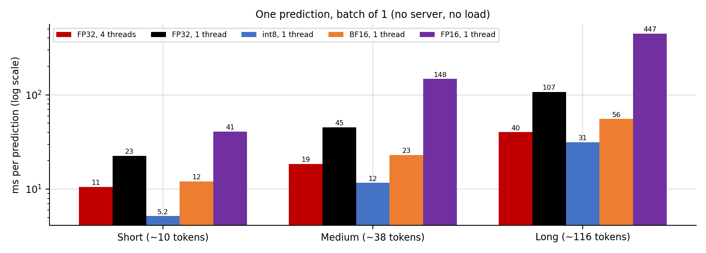


**How to read the three graphs.** In each, follow the request towers down to the `Linear` layers and look at which library the bottom frames belong to. That is the code doing the arithmetic for that format:

| Format | Bottom frames under the Linear layers | Library | Search | What it means |
|---|---|---|---|---|
| int8 | quantized Linear calls (`torch/_ops.py`), FBGEMM quantize routines (B) | FBGEMM | 45.5% | int8 kernels using the CPU's AVX-512 VNNI instructions |
| BF16 | `ideep::matmul_forward` and the `linear.py` frames above it (B) | oneDNN | 63.5% | BF16 kernels using the CPU's AVX-512 BF16 instructions |
| FP16 | `at::native::AVX2::fp16_dot_with_fp32_arith` (A) | PyTorch fallback | 80.7% | a generic dot-product routine that converts to FP32; no native FP16 path on this CPU |

The FP16 graph is the clearest: one function covers four-fifths of it. Its name says what it does: a dot product, using AVX2 (older, narrower instructions), with FP32 arithmetic. The CPU flags confirm why: avx512_vnni and avx512_bf16 are present, avx512_fp16 is not.

- **4.6 Hardware support decides the format results.** *Reason:* int8 and BF16 run on optimised libraries that use instructions this CPU has, and are 3.4–4.4× and 1.9–2.0× faster per prediction; FP16 falls back to a slow routine and gets worse with longer texts and larger batches.
- **4.7 Converted workers keep the memory of the FP32 model loaded first.** *Reason:* each worker loads FP32, then converts; freed memory stays with the process, and the PyTorch runtime is a large fixed share (explains 3.4).

**Why Stage 5 was designed this way.** Profiling confirmed Stages 2–3: single-threaded workers use the cores best (4.2, 4.3), limit 2 removes most GIL contention while keeping cores busy (4.4), the int8 and BF16 gains rest on CPU instructions (4.6), and layouts with several multi-threaded predictions per worker should be avoided (4.5). The final configuration therefore combines **8×1, limit 2** with **int8**, or **BF16** where accuracy must not change, compared against a baseline from the same sitting.

# Stage 5. Final configuration

**Question.** How does the configuration chosen from Stages 2–4 compare with the default?

**What was run.** The two candidates are the `int8-8x1-limit2` and `bf16-8x1-limit2` sessions of the Stage 3 batch (`profiling/results/experiments_20261025-152828/`), which ran step, length and spike against a baseline from the same sitting on the same 8 cores. They are packaged as settings profiles:

```
PROFILE=throughput bash scripts/run_server.sh 0-7    # int8, 8 workers x 1 thread, limit 2
PROFILE=accuracy   bash scripts/run_server.sh 0-7    # BF16, 8 workers x 1 thread, limit 2
```

**Results.**

| Metric | Baseline FP32 2×4 | int8 8×1 limit 2 | BF16 8×1 limit 2 |
|---|---|---|---|
| Peak throughput | 129.6 req/s | 491.6 req/s (3.8×) | 282.9 req/s (2.2×) |
| At 64 users | 115.2 req/s | 485.8 req/s (4.2×) | 280.4 req/s (2.4×) |
| p50 at 1 user | 18 ms | 8 ms | 22 ms |
| p95 / p99 at 64 users | 830 / 930 ms | 260 / 350 ms | 420 / 540 ms |
| Spike, 64-user stage | 117 req/s, p95 820 ms | 485 req/s, p95 310 ms | 279 req/s, p95 435 ms |
| SST-2 accuracy | 91.06% | 89.91% | 91.06% |
| Peak server memory | 2.23 GB | 5.14 GB | 4.66 GB |
| Requests per GB at peak | 58 | 96 | 61 |
| Failures | 0 | 0 | 0 |

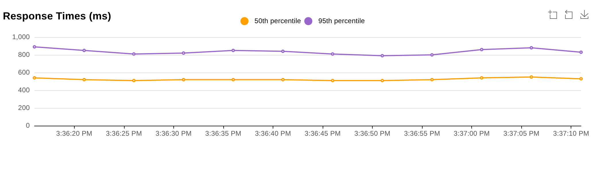

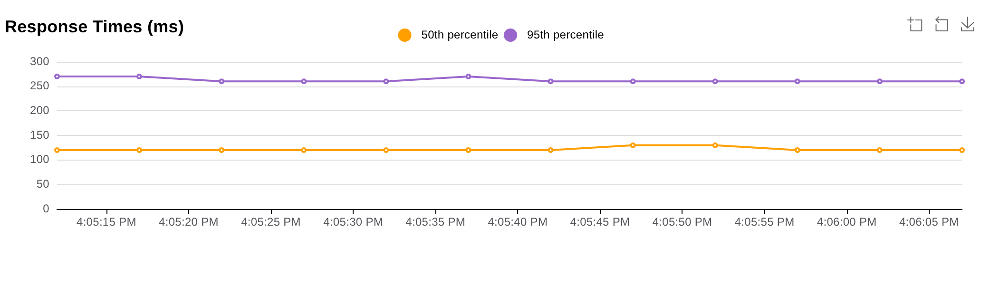

**Conclusions.**

- **5.1 int8, 8×1, limit 2 is the throughput-first choice.** *Reason:* 3.8× peak, 4.2× at 64 users, the lowest latency at every load, and the most requests per GB (96 vs 58 for the baseline).
- **5.2 BF16, 8×1, limit 2 is the accuracy-first choice.** *Reason:* 2.2× peak with unchanged accuracy, using a fully supported PyTorch feature.
- **5.3 Both need 2.1–2.3× the baseline's memory.** *Reason:* each of the 8 workers holds its own runtime and model.

# Conclusions and recommendation

| Stage | Finding | Consequence |
|---|---|---|
| 1 | Saturates at ~130 req/s; loses throughput under contention while the CPU stays busy | Try other layouts |
| 2 | No layout gains more than 8%; each FP32 core gives ~18 req/s | Only cheaper predictions can help |
| 3 | int8 3.5×, BF16 2.0×; FP16 slower | Explain before choosing |
| 4 | Model ~99% of work; oversubscription explains falling throughput; the limit removes GIL contention but throughput is set by computation; CPU instructions explain formats | Layout and formats confirmed |
| 5 | int8 8×1 limit 2: 3.8× peak, p95 −69% at 64 users; BF16 2.2× with no accuracy loss | Recommended profiles |

**Recommended settings** (`profiles/`):

```
PROFILE=throughput   # APP_QUANTIZE=true GUNICORN_WORKERS=8 APP_TORCH_NUM_THREADS=1 APP_MAX_CONCURRENT_PREDICTIONS=2
PROFILE=accuracy     # APP_PRECISION=bf16 GUNICORN_WORKERS=8 APP_TORCH_NUM_THREADS=1 APP_MAX_CONCURRENT_PREDICTIONS=2
```

The code defaults stay at the conservative FP32 2 × 4 configuration, which needs less memory and makes no assumptions about CPU instruction support; the profiles are applied explicitly.

**Trade-offs and limitations.**

- int8 costs about one accuracy point, and PyTorch has deprecated the quantized tensor types it relies on.
- Eight workers need 4.7–5.1 GB at peak, against 2.2 GB for the default, because each worker holds its own copy of the model.
- The 15-minute soak test was run on the default configuration; the recommended profiles were tested with step, length and spike runs.
- Uneven connections at 4–16 users are partly caused by Locust's few persistent connections; production traffic, or a load balancer distributing individual requests, would spread load more evenly.
- Only the baseline was repeated, so small differences, especially in tail latency, are read against the run-to-run variation measured in Stage 1.
- Accuracy was measured on SST-2 sentences, all shorter than 64 tokens, so the effect of truncating long reviews is not covered.